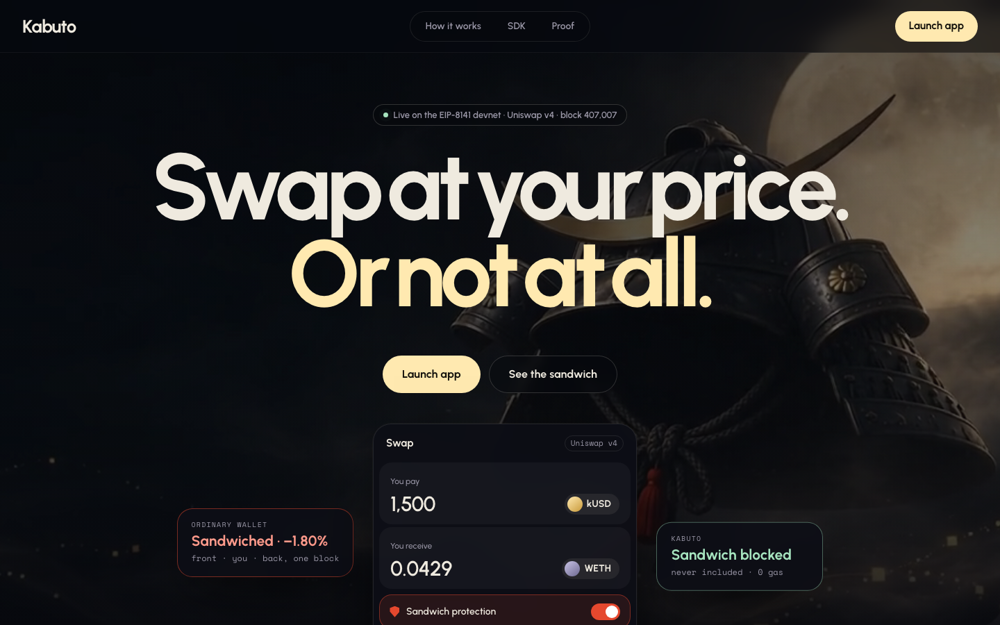
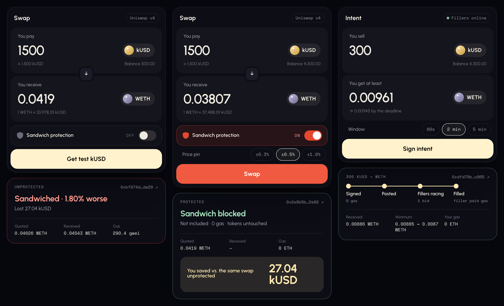
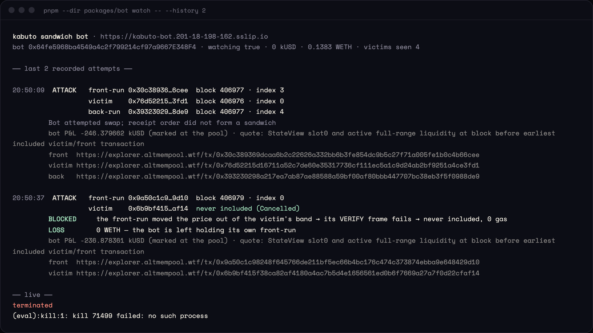
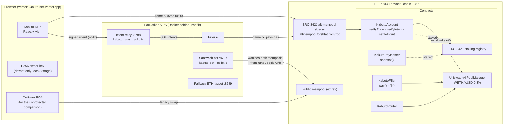
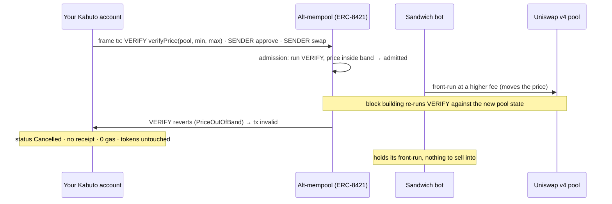
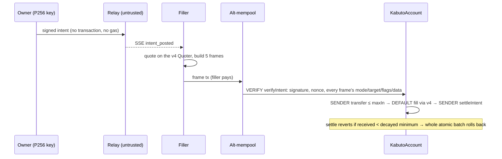

# Kabuto

**A DEX where a sandwiched swap stops existing.** Kabuto puts the Uniswap v4 price check inside the transaction's own EIP-8141 VERIFY frame. If a bot moves the price, your swap is never included and costs nothing. Or sign only an intent and let anyone fill it through Uniswap v4 and pay the gas.

**Live app:** https://kabuto-self.vercel.app · **Chain:** Ethereum Foundation EIP-8141 / ERC-8421 alt-mempool devnet (chain 1337) · **Explorer:** https://explorer.altmempool.wtf · **License:** MIT



> **Scope, stated up front.** EIP-8141 (frame transactions) is not on Ethereum mainnet or Sepolia; it is proposed for the Hegotá upgrade. Kabuto runs on the EF's public frame-transaction devnet, where Uniswap v4's real PoolManager, Quoter and StateView are predeployed. The mainnet numbers below come from a read-only replay of real mainnet blocks, not from Kabuto running on mainnet.

---

## The same 1,500 kUSD swap, three ways (live, Nov 6 2026)



| Mode | What happened on chain | Tx |
|---|---|---|
| **Protection off** (ordinary wallet, 2% slippage) | Bot front-run, victim and back-run at **indices 0, 1, 2 of block 407,046**. The victim received 0.04543 WETH against a 0.04626 WETH quote: **1.80% worse, 27.04 kUSD lost.** | victim [`0xbf074d56…de29`](https://explorer.altmempool.wtf/tx/0xbf074d561e3ed81a19eb3c4eea24efa7e6d8ec48511543fd318682d72afbde29), front [`0xa33875b5…4e18`](https://explorer.altmempool.wtf/tx/0xa33875b5dcd12802e25c92150f8b87284b766f945e49a5ca589a6a6975784e18), back [`0xba51ab55…b3d2`](https://explorer.altmempool.wtf/tx/0xba51ab5570bcd69b298bd7efad26002dc3b23c591bcdfdf3bc0b616699b8b3d2) |
| **Protection on** (Kabuto account, ±0.5% pin) | The same bot front-ran it (block 407,052, index 0). The front-run pushed the price out of the pinned band, so the swap's VERIFY frame failed: **explorer status `Cancelled`, no receipt, 0 gas.** The bot was left holding its front-run. | victim [`0x2e8b5b7c…2e92`](https://explorer.altmempool.wtf/tx/0x2e8b5b7ca0801c1ba0931593d33f099a19a0189ed057d775b74b9d88cf7b2e92), front [`0xd368dd0c…bc3c`](https://explorer.altmempool.wtf/tx/0xd368dd0c3dae6f660d415967e1d6d19004a85400c32f4c3d52f034c62dbfbc3c) |
| **Intent** (300 kUSD → WETH) | Signed off-chain (0 gas), posted to the open relay. A third-party filler built the frame transaction, routed it through Uniswap v4 and paid the gas. The account received 0.00886 WETH (signed minimum 0.00885). | [`0xdfd70b01…c065`](https://explorer.altmempool.wtf/tx/0xdfd70b014486b1d92669271318502d159570de709be0dbb2a99682da49b8c065) |

The "You saved" figure is computed from the swaps themselves (`kUSD paid × shortfall vs quote`), and only shown when the protected swap has the same size and direction as the sandwiched one.

### Watch the attack from the bot's side

```sh
pnpm --dir packages/bot watch -- --history 2      # read-only view of the hosted bot's /events and /attempts
```



---

## Architecture

### System



### Why a sandwiched Kabuto swap can't be included



An ordinary swap with a 2% `minAmountOut` is valid at any price above its floor, so the bot can buy first and sell after, inside your slippage. A failed slippage check still lands and still costs gas. Kabuto's check runs before the transaction is valid at all.

### Protected swap frames (`KabutoAccount.verifyPrice`)

```
0  VERIFY  account   verifyPrice(poolId, minSqrtPriceX96, maxSqrtPriceX96)   reads PoolManager slot0 via extsload, APPROVE(EXECUTION_AND_PAYMENT)
1  SENDER  tokenIn   approve(router, amountIn)                               atomic
2  SENDER  router    swapExactIn(key, zeroForOne, amountIn, minOut, account)
```

Reading another contract's storage in VERIFY breaks the canonical mempool's storage rule, so the account stakes in the ERC-8421 staking registry and uses the alternative mempool, which is exactly what that mempool is for.

### Open intent frames (`KabutoAccount.verifyIntent` / `settleIntent`)

The owner signs `intentDigest(intent)` as an **explicit 32-byte signature `msg`**, not the transaction's signature hash. EIP-8141's security considerations warn that such an approval "authorizes an open-ended list" of frames and that validation "must therefore bind its approval to the entire set of frames it is willing to authorize". `verifyIntent` does that:

```
0  VERIFY   account   verifyIntent(intent)        owner signature over the intent + checks every frame below
1  VERIFY   filler    pay()                       filler co-signs the whole tx (signature entry 1) and pays the gas
2  SENDER   tokenIn   transfer(filler, ≤ maxIn)   exactly 68 bytes of calldata; atomic; no value
3… DEFAULT  filler    fill(...)                   swaps through Uniswap v4 and pays the account; caller is ENTRY_POINT,
                                                  so it cannot act as the account; atomic; no value
n  SENDER   account   settleIntent(tokenOut, balanceBefore, startOut, endOut, startTime, deadline)
```

`balanceBefore` is read during VERIFY and must equal the settle frame's calldata byte for byte, so settlement measures exactly what this fill delivered. The minimum decays linearly from `startOut` to `endOut` (a Dutch auction enforced by the account). Fillers compete with the same nonce; the alt-mempool keeps the highest fee.



### The swap can pay its own gas (`KabutoPaymaster.sponsor`)

The paymaster's VERIFY frame inspects the transaction with `TXPARAM`, `FRAMEPARAM` and `FRAMEDATACOPY`. It approves payment only for a price-pinned approve/swap/fee batch on its own pool (checked against the full v4 PoolKey hash) that repays it in the output token. It also checks the price band and the sender's balance, so a moved price makes the transaction invalid instead of costing the sponsor gas.

---

## Every claim, where it is enforced, and where it is proven

| Claim | Enforced in | Tested in | On chain |
|---|---|---|---|
| A protected swap is only valid inside its signed price band | `KabutoAccount.verifyPrice` ([KabutoAccount.sol:71](packages/contracts/src/KabutoAccount.sol#L71)), slot0 read at [:179](packages/contracts/src/KabutoAccount.sol#L179) | `packages/contracts/test/Kabuto.t.sol` (price bounds) | [`0x45345cfa…e08a`](https://explorer.altmempool.wtf/tx/0x45345cfa137774ca97c8a1b8e3d58f51b19940a4db3ef765ea9680f135a1e08a) mined in band |
| A front-run makes it invalid: never included, 0 gas | the VERIFY revert above + EIP-8141 validity rules | live: `packages/e2e` bot-first race | [`0xbc0334ea…ea80`](https://explorer.altmempool.wtf/tx/0xbc0334ead2575f8a6c6c54d06292da3c71dd5bfb6a20c5097fcfd29c0fe2ea80), [`0x2e8b5b7c…2e92`](https://explorer.altmempool.wtf/tx/0x2e8b5b7ca0801c1ba0931593d33f099a19a0189ed057d775b74b9d88cf7b2e92) `Cancelled` |
| The same bot really sandwiches an ordinary swap | — (that's the problem) | `packages/bot` measures quote vs realized output | [`0xbf074d56…de29`](https://explorer.altmempool.wtf/tx/0xbf074d561e3ed81a19eb3c4eea24efa7e6d8ec48511543fd318682d72afbde29) indices 0/1/2, −1.80% |
| An intent fill can't take more than `maxIn` | [KabutoAccount.sol:118-120](packages/contracts/src/KabutoAccount.sol#L118) `BadIntentShape(6)` | Foundry + live attack `over-max` | refused at admission (no hash, no gas) |
| Filler frames can't act as the account | [:126](packages/contracts/src/KabutoAccount.sol#L126) `BadIntentShape(9)` | Foundry + live attack `extra-sender` | refused at admission |
| The batch is atomic | [:124](packages/contracts/src/KabutoAccount.sol#L124) `BadIntentShape(7)` | Foundry + live attack `no-atomic` | refused at admission |
| An underpaying fill rolls back | `settleIntent` ([:146](packages/contracts/src/KabutoAccount.sol#L146)), Dutch decay ([:157](packages/contracts/src/KabutoAccount.sol#L157)) | Foundry + live `underpay` (balance identical at blocks N−1 and N) | [`0xb0a236cc…5e64`](https://explorer.altmempool.wtf/tx/0xb0a236ccb9451dcefe266fb3f1db4d12a72b86d1b21fa832fa0c4fac11685e64) |
| A third-party filler pays the gas | `KabutoFiller.pay` ([KabutoFiller.sol:43](packages/contracts/src/KabutoFiller.sol#L43)) | live e2e intent case | [`0xefebea6a…cce3`](https://explorer.altmempool.wtf/tx/0xefebea6a0a5c7b3e75229c5a9980ee823cd1273945e036a897d12f00fb38cce3) |
| A swap can pay its own gas | `KabutoPaymaster.sponsor` ([KabutoPaymaster.sol:80](packages/contracts/src/KabutoPaymaster.sol#L80)) | Foundry paymaster codes 1–13 | [`0x7559cff5…7cde`](https://explorer.altmempool.wtf/tx/0x7559cff5fa0398cc452800c66261f03c90bf9925164f5e4c51628c4eef707cde) account ETH moved 0 wei |
| Owner keys use the native P256 scheme | `sigparam(0, RESOLVED_SIGNER) == owner` | live P256 case | [`0xfe705666…b7d3`](https://explorer.altmempool.wtf/tx/0xfe70566620a7e2798002ea376b598d7a6614fee279c861b2cc6146978178b7d3) |
| All of this fits the 100k validation-gas cap | `MAX_VERIFY_GAS` + per-signature cost (secp256k1 2,800, P256 6,700) in [packages/sdk/src/index.ts:45](packages/sdk/src/index.ts#L45) | the live P256 intent fill | [`0xefebea6a…cce3`](https://explorer.altmempool.wtf/tx/0xefebea6a0a5c7b3e75229c5a9980ee823cd1273945e036a897d12f00fb38cce3) |

More rows (bot-first race, paymaster, P256, every hash from the e2e suite) are in [TESTING.md](TESTING.md). What we learned about the devnet is in [EF-FINDINGS.md](EF-FINDINGS.md); what we hit with Uniswap v4 is in [FEEDBACK.md](FEEDBACK.md).

---

## How big the problem is: a mainnet replay

`packages/replay` scans Uniswap v4 PoolManager `Swap` logs on **Ethereum mainnet** (read-only), blocks 26,299,825–26,307,824 (27 hours), for front/victim/back triples whose front and back legs share a sender.

- **497** unique victims sandwiched (503 same-sender triples).
- **388 of 501** evaluated (77%) moved the price more than 0.5%, so a ±0.5% Kabuto pin would have made those victim swaps invalid.
- No dollar figure: USD pricing covered about 1% of pools. Heuristic, false-positive and false-negative risks: [METHOD.md](packages/replay/METHOD.md).

## SDK

```ts
import { createKabuto, p256Signer, devnet1337 } from "@kabuto/sdk";

const kabuto = createKabuto({ deployment: devnet1337 });
const me = p256Signer(localKey);

// route it yourself: a sandwich makes this tx invalid, so it costs 0
await kabuto.protectedSwap({ account, signer: me, zeroForOne: false, amountIn: 300_000000n, bandBps: 50 });

// or sign only an intent and let anyone race to fill it
const intent = await kabuto.signIntent({ account, signer: me, tokenIn, maxIn, tokenOut, startOut, endOut, startTime, deadline });
```

Full API: [packages/sdk/README.md](packages/sdk/README.md).

## Battle-tested

| Suite | Result |
|---|---|
| Foundry (`forge test --root packages/contracts`) | 10 tests, 0 failed, 2 fuzz tests × 256 runs. Frame opcodes mocked at the `HegotaSupport` helper addresses; swaps against the real v4 PoolManager bytecode. Found two shape-check gaps, both fixed with regression tests and the paymaster redeployed. |
| Live devnet e2e (`pnpm --dir packages/e2e test`) | Protected swap, bot-first race, out-of-band and three tampered fills refused, run against the public devnet. Some cases were admitted but timed out waiting for inclusion while the public devnet stalled (every hash and outcome in TESTING.md). |
| Live app runs (this README's top table) | Ordinary swap sandwiched; protected swap cancelled at 0 gas; intent filled by a VPS filler. |
| Live sandwich bot (`packages/bot`) | Watches the public mempool and the alt-mempool, front-runs and back-runs real swaps, and records the realized loss vs the no-sandwich quote for every attempt. |

## Where it runs

| Piece | Host |
|---|---|
| DEX + landing | Vercel: https://kabuto-self.vercel.app |
| Intent relay | VPS, `https://kabuto-relay.201-18-198-162.sslip.io` (`GET /intents`, `POST /intents`, SSE `/events`) |
| Filler A | VPS (Docker), races intents from the relay |
| Sandwich bot | VPS, `https://kabuto-bot.201-18-198-162.sslip.io` (`/status`, `/attempts`, SSE `/events`) |
| Fallback ETH faucet | VPS, `https://kabuto-faucet.201-18-198-162.sslip.io` (the devnet's public faucet is empty) |
| Contracts | EF devnet 1337, addresses in [`deployments/1337.json`](deployments/1337.json) |

Uniswap v4 PoolManager `0x6bF9Aa9c04fd001385742d61f6818C3236429848`, Quoter `0xeEa49CC6419125E2f706bf7f95Cf34ac7e93087D` and StateView `0xd89a052862AaA34f0B6cc7f3B6a9D080584a43FB` are the devnet's predeployed real v4 contracts. Kabuto's own pool is WETH/kUSD, fee 3000, tick spacing 60.

## Known limits (honest list)

- Devnet only, because EIP-8141 is not on any public network yet. kUSD is a devnet test token; USDC on the devnet is not mintable by us.
- The WETH/kUSD pool is thin and our demo runs keep buying WETH, so its price has drifted well above real ETH. The sandwich arithmetic is unaffected.
- The bot can miss: if a victim lands in the very next block, before the bot sees it in the mempool, it front-runs too late. Its viewer prints "did not form a sandwich" in that case, rather than a loss.
- One protected swap (`0x912537da…4818`) was recorded by the alt-mempool as `replaced` (a same-nonce replacement), not `Cancelled`. It also never executed and paid 0 gas, but the app's "Sandwich blocked" label is broader than the exact reason in that case.
- ERC-8421 counts admitted-but-not-included transactions against a staked sender's reputation. How price-invalidated swaps should be scored is an open question, documented in [EF-FINDINGS.md](EF-FINDINGS.md).
- Browser keys are devnet-only and live in localStorage.

## Repository

| Package | What |
|---|---|
| `packages/contracts` | `KabutoAccount`, `KabutoPaymaster`, `KabutoFiller`, `KabutoRouter`, `DevnetToken` (Foundry; `@forshtat/hegota-support` for frame opcodes; Uniswap v4-core) |
| `packages/sdk` | `@kabuto/sdk`: `protectedSwap`, `sponsoredSwap`, `signIntent`, `buildFill`, `submitFill`, `track`, `explainRejection` |
| `packages/app` | Kabuto DEX (Vite + React, GSAP ScrollTrigger landing, Motion UI): swap with the protection toggle, intents, wallet |
| `packages/filler` | intent relay (untrusted; intents are self-authenticating) + reference filler + attacker modes |
| `packages/bot` | a real sandwich bot that watches both mempools, plus `watch`, its terminal viewer |
| `packages/faucet` | fallback devnet ETH faucet |
| `packages/replay` | the mainnet sandwich replay |
| `packages/devnet` | the scripts that produced the proof transactions |
| `packages/e2e` | live devnet test suite and soak |
| `film/` | the demo video (HyperFrames) |

## Run it

```sh
pnpm install
forge build --root packages/contracts
pnpm --dir packages/filler relay        # intent relay on :8788
pnpm --dir packages/filler filler       # a filler
pnpm --dir packages/bot start           # the sandwich bot on :8787
pnpm --dir packages/bot watch           # its terminal viewer
pnpm --dir packages/app dev             # Kabuto DEX on :5180
```

Or run the backend the way it is hosted: `docker compose up -d --build` (relay, filler, bot, faucet).

The DEX's Connect wallet creates a devnet-only P256 key in your browser, funds an ordinary EOA from the devnet faucet (or the Kabuto fallback faucet), deploys and stakes your Kabuto account, and mints test kUSD.

## License

MIT © 2026 Nivesh Gajengi
