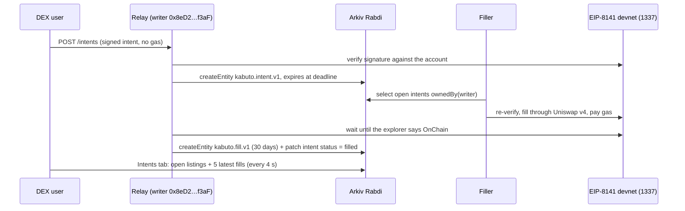

# How Kabuto uses Arkiv (how-you-use-Arkiv criterion)

## Writes (relay, owner of every entity)
| Step | Code |
|---|---|
| Schemas `kabuto.intent.v1` and `kabuto.fill.v1` | [`packages/filler/src/arkiv.ts:12-21`](../packages/filler/src/arkiv.ts#L12) |
| Create the intent entity, expiring at the signed deadline (`ExpirationTime.atDate`) | [`arkiv.ts:41-49`](../packages/filler/src/arkiv.ts#L41) |
| Create the fill entity, 30-day expiry | [`arkiv.ts:51-58`](../packages/filler/src/arkiv.ts#L51) |
| Patch the intent's `status` (only the owner can) | [`arkiv.ts:60-63`](../packages/filler/src/arkiv.ts#L60) |
| A landed fill is published only after the devnet confirms it on chain | [`packages/filler/src/relay.ts:58`](../packages/filler/src/relay.ts#L58) |

The relay replies to the poster first and publishes in the background, recording the entity key in its event journal (visible in SSE events and `GET /intents`). `GET /arkiv` shows the writer, its balance, the publication count and the last error.

## Reads (user-facing and filler)
| Reader | Code |
|---|---|
| DEX Intents tab: open intents and the 5 most recent fills, every 4 s, with explorer links | [`packages/app/src/lib/arkiv.ts:22-50`](../packages/app/src/lib/arkiv.ts#L22), rendered by `ArkivBoard` in [`packages/app/src/Dex.tsx:323`](../packages/app/src/Dex.tsx#L323) |
| Filler `--source arkiv`: polls open intents every 2 s, re-verifies on chain 1337, fills | [`packages/filler/src/arkiv.ts:65`](../packages/filler/src/arkiv.ts#L65), [`packages/filler/src/filler.ts:85-89`](../packages/filler/src/filler.ts#L85) |

Every reader filters `ownedBy(writer)`, because anyone can write an entity with the same schema name.

## Live
- Writer `0x8eD225Ae7f4b445Bfee6ad5dd9719C59426Af3aF`; fill entity [`0xd9cc8020…4e5f`](https://rabdi.explorer.arkiv.network/entity/0xd9cc8020d93d9bdae3052f914a1770613cc2c4958edaf72cf0621cca76fd4e5f) linking intent `0xd309c13a…20d0` (since expired, as designed) to devnet fill `0xd498630c…752b`.
- Test: `pnpm --dir packages/filler exec vitest run test/arkiv.test.ts`: byte round trip and a live public Rabdi read pass; the live write case runs only when a funded `ARKIV_PRIVATE_KEY` is in the environment.
